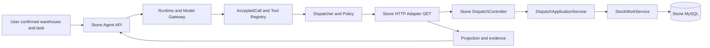

# Stone 业务接入与演进

## 1. 代码依据

分支：`Rookiefreshman/Stone`, `codex/implement-java-version-of-design-rules-cqmdqu`。

- [DispatchController](https://github.com/Rookiefreshman/Stone/blob/codex/implement-java-version-of-design-rules-cqmdqu/src/main/java/com/stone/wms/interfaces/controller/DispatchController.java)
- [OutboundOrderController](https://github.com/Rookiefreshman/Stone/blob/codex/implement-java-version-of-design-rules-cqmdqu/src/main/java/com/stone/wms/interfaces/controller/OutboundOrderController.java)
- [StockWorkDetailDto](https://github.com/Rookiefreshman/Stone/blob/codex/implement-java-version-of-design-rules-cqmdqu/src/main/java/com/stone/wms/application/dto/StockWorkDetailDto.java)
- [DispatchTask](https://github.com/Rookiefreshman/Stone/blob/codex/implement-java-version-of-design-rules-cqmdqu/src/main/java/com/stone/wms/domain/model/dispatch/DispatchTask.java)
- [库存作业规则](https://github.com/Rookiefreshman/Stone/blob/codex/implement-java-version-of-design-rules-cqmdqu/docs/stock-work-execution.md)

`docs/api.md` 的仓库/波次/单据/库存列表属于目标设计，不当成已发布 API。现有响应为 `ApiResponse<T>` (`success/message/data`)，必须检查业务 success 而非仅 HTTP 200。仓库 ID / 任务 ID 为 Java long，不是目标文档中统一 UUID 的形式。

## 2. 当前真实接入

`get_stock_work_detail@1` → `StoneHttpService.get_detail` → `GET /api/wms/warehouses/{warehouseId}/stock-work/{taskId}` → `DispatchController.stockWork` → `DispatchApplicationService.stockWorkDetail` → `StockWorkService.detail` → `StockWorkDetailDto`。该 Java 查询在 readOnly、REPEATABLE_READ 事务中读取作业和流水。Adapter 投影 `task.id/taskKey/priority/state/work` 及 `ledger`，过滤 `claimKey/deviceCode/receiptKey`。任务 ID 一致性检查，严格数据类型，错误映射，固定路径，禁止重定向，有限响应大小。当前证据是接口投影的 hash 和观察时间，不是领域签名或数据库版本。404 仅在 Stone 风格失败 envelope 下映射 NOT_FOUND；须在真实接口联调时确认语义。Stone DTO 不含 warehouseId，仓库校验依赖可信服务查询范围。未实现字段级企业授权，开发环境隔离是必要前提。

## 3. 工具路线图（未实现项不得注册）

| 能力 | 真实源码接口 | 分类及实现条件 |
|---|---|---|
| get_stock_work_detail | GET /api/wms/warehouses/{warehouseId}/stock-work/{taskId} | READ，当前实现 |
| allocate_outbound | POST /api/wms/outbound-orders/{orderId}/allocate | WRITE，需出库单只读前置接口、审批、订单版本/归属检查、领域幂等回执及对账 |
| register_receipt_line | POST /api/wms/warehouses/{warehouseId}/receipt-lines | WRITE，receiptKey 幂等语义需核验，真实实收证据/权限/回执及状态查询 |
| submit_stock_work | POST /api/wms/warehouses/{warehouseId}/stock-work | WRITE，PUTAWAY/TRANSFER 区分、taskKey、数量/库位/批次校验、审批、按业务键查回执 |
| cancel_stock_work | POST /api/wms/warehouses/{warehouseId}/stock-work/{taskId}/cancel | WRITE，READY、重新查状态、审批、并发状态与回执校验 |
| freeze/unfreeze_location | POST /api/wms/warehouses/{warehouseId}/locations/{locationId}/freeze 或 unfreeze | WRITE，freezeKey、现场盘点依据、权限、库位状态与回执查询 |
| WES enqueue/claims/events | POST /api/wes/warehouses/{warehouseId}/tasks、claims、tasks/{taskId}/events | 保留给可信 WES/设备；Agent 不冒充设备、不伪造作业反馈 |

首期优先新增业务侧只读 API（出库单详情、库存余额、库位容量、按 taskKey 查询及受控流水查询），由 Stone 团队根据 DDD 新增 Application Service 和 Controller，绝不让 Agent 自由执行 SQL。接口存在性、鉴权、分页与一致性须经过真实契约验收。此表为实施设计，不代表新增接口已存在。

## 4. 状态解释和安全工作流

READY 待领取；IN_FLIGHT 处理中；UNKNOWN 未确认，库存/容量预占保留，必须现场核对；SUCCEEDED 任务成功；FAILED 任务失败；CANCELLED 取消。Agent 不从 UNKNOWN 推断实际位置，也不将提交任务等同完成实物作业。作业失败原因不能从当前详情接口单独推断；需设备故障和回执查询能力。输出真实流水，不用字段自行重算账面余额。

后续写入使用固定业务流程：授权读取→确认目标和资源版本→生成不可变草案→批准→重新授权/状态校验→持久 operation_id→调用领域接口→可信回执/对账→展示提交状态与业务进度。现有 Stone 业务幂等键不等同于 Agent Operation 完整协议；特别是灾难恢复、未知提交、按业务键查回执及旧请求 fencing 尚待领域 Owner 确认。未验收则关闭写入。不得让模型提交 WES 设备反馈。

## 5. 工程差距及验收

当前 41 项测试覆盖固定 HTTP 传输契约、错误映射、授权、调用参数、恢复与幂等。HTTP server 是本地测试替身，不是 Stone Java/MySQL；模型是确定性 fixture。生产差距：真实接口联调、独立 PostgreSQL migration/并发与持久 job、企业身份/仓库级及字段级授权、跨租户数据隔离、完整自然语言目标确认、真实模型评测、监控/数据留存、CI 和 HA。P2/P3 扩展需基于这些真实结果，不提前暴露写操作。

## v0.2：自由文本目标提议

新增 `agent/goal_proposal.py`：独立控制提议 Schema `propose_stock_work_goal`，不在业务 Registry 注册。默认有限语法 fixture，可选真实 Chat Completions；提议结果只允许 NEEDS_CONFIRMATION / NEEDS_INPUT / UNSUPPORTED / PROPOSAL_FAILED。数字原文检查和仓库授权拦截，不把模型自报语义当成事实。

确认通过现有结构化 Run API 创建新只读任务，M06 仍校验正式接受记录、目标、工具绑定和仓库授权。该版本未实现持久 proposal_id / 确认凭证、跨轮上下文、统一提议调用账本、生产授权或真实模型评测。下一步应实现这些协议与 PostgreSQL repository，再进行真实 Stone 联调。

## v0.3：会话持久化及确认绑定

新增托管 Session API 和 `agent/session.py`，以 SQLite 短事务实现 proposal revision、有限语法的上下文继承、候选有效期、精确确认及 Run 幂等绑定。旧无会话入口仅用于兼容测试，不可绕过托管会话确认。参见 [会话协议](SESSION_PROTOCOL.md)。当前 85 项本地测试全部通过；真实 LLM、Stone Java/MySQL、PostgreSQL、统一预算与生产身份尚未验收。
