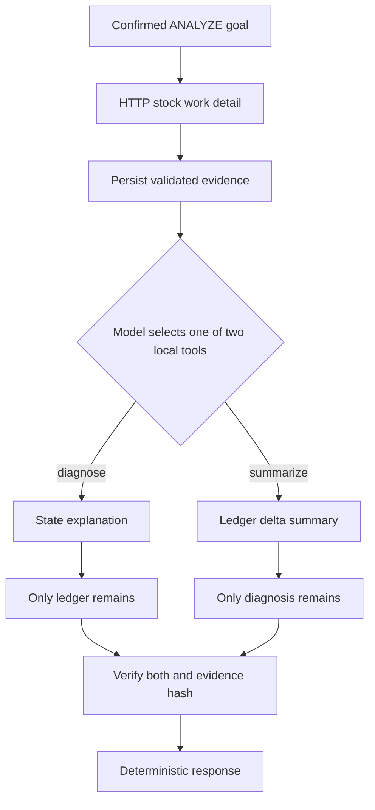

# Stone Agent v0.5 多步骤业务执行与证据分析

## 1. 业务接入与非目标

以原 Stone `codex/implement-java-version-of-design-rules-cqmdqu` 分支的实际 Controller/DTO 以及 v0.4 适配代码为依据。真实可调用端点只有 `GET /api/wms/warehouses/{warehouseId}/stock-work/{taskId}`；返回 `ApiResponse<StockWorkDetailDto>`，含 `task`、`ledger`。不注册尚未实现的库存余额、出库单详情、库位容量查询。原仓库没有改动。

| 工具 | 类型 | 执行器 | 业务数据 |
|---|---|---|---|
| `get_stock_work_detail` | HTTP READ | `StoneHttpService.get_detail` | 真实端点或测试 fixture |
| `diagnose_stock_work` | LOCAL READ | `agent.tools.diagnose` | 同 Run 首步的授权且校验过的结果 |
| `summarize_stock_work_ledger` | LOCAL READ | `agent.tools.summarize_ledger` | 同 Run 首步的授权且校验过的流水 |

所有参数都是 `StockWorkArgs`；禁止模型指定证据引用、租户、凭证、URL、HTTP 方法、SQL 或执行器。LOCAL 两个工具不发网络业务请求；诊断解释状态且根因始终 UNDETERMINED，流水汇总按库位对接口已返回的 delta 求和，不代表当前库存余额或全仓账。完整分析目标包含这两个子目标，不包含保证查明根因。

## 2. 目标与完成条件

| GoalContract.kind | 逻辑步骤 | 完成条件 |
|---|---|---|
| READ_STOCK_WORK | 1 次详情读取 | 完整真实结果（含授权可披露的 NOT_FOUND） |
| DIAGNOSE_STOCK_WORK | 详情 → 规则诊断 | 两步完成；无记录则 PARTIAL |
| COMPARE_STOCK_WORK | 2–3 个明确不同目标逐一详情读取 | 每个目标有合法读取结果；NOT_FOUND 明确展示；技术失败返回已完成证据与 PARTIAL |
| ANALYZE_STOCK_WORK | 详情 → 两个 LOCAL 工具（顺序由模型选择） | 两个分析各完成一次，均引用首步证据；无记录则 PARTIAL |

`run.state=COMPLETED` 表示有界流程正常终止，`outcome.goal_status` 才表述目标覆盖。中途技术/协议失败标 FAILED，已验证结果可保留 PARTIAL；取消标 CANCELLED。比较不是同一数据库事务快照，每个结果保留 observed_at 和 source。不同仓库的结构化 API 目标全部须授权；CLI 比较限同一仓库。



本版不是任意多 Agent 或自由 DAG。每一步独立请求模型，不重放 provider 原生 tool-call 历史；只传已确认参数、原请求文本和当前候选 Schema，业务流水不发给模型。完整分析的第二步可在两种工具中动态选择，第三步候选移除已完成工具。其他路径是固定有界计划。只有已确认结构化目标可进入新模式；托管 Session 的自然语言提议仍只支持单目标读取，不能通过旧接口绕开确认。后续可扩展持久化多目标 Proposal 及真实模型原生多轮历史，但必须单独验证。

## 3. 执行账本与恢复

- `model_attempt.step_no`：逻辑步骤从 1 开始，`attempt_no` 仍是 run 全局递增；唯一部分索引 `(run_id,step_no) WHERE accepted=1`。
- `invocation.step_no`：`UNIQUE(run_id,step_no)`；T3 按请求 ID、run、step、fence 原子接受；读取联接同时校验步骤归属。
- 每一步最多 2 次模型请求及 2 次安全只读派发；每 Run 最多 3 步、6 次模型尝试，模型账本预留 4096 token/次，累计预算为 8192 × 计划步数（估算而非 tokenizer 硬限制）。
- 恢复逐步加载已接受/完成记录；已保存结果通过 hash、实体、绑定及依赖验证；LOCAL 输出重新计算以核验同一首步证据。已完成步骤不重复派发业务 HTTP。未保存的只读结果允许安全重读，不能保证网络 exactly-once。
- 运行前检查全部实体权限，执行前按步骤再次校验；读取最终结果检查全部目标权限。当前 principal 仍是开发配置快照，未实现企业 PDP、实时撤销通知或外部业务域认证，不能生产部署。

## 4. 迁移 SOP

停止旧 API / Worker，备份 v0.4 独立 Agent 数据库。SQLite 自动迁移在短事务内为 model_attempt 加 step_no，重建 invocation 唯一约束并保留旧记录 step 1；已执行本地旧数据迁移与重复打开测试。PostgreSQL 新 migration `0002_steps` 在旧 revision `0001_agent` 上增加两列、替换唯一索引和约束。先运行 `alembic upgrade head`，确认 `alembic current` 为 `0002_steps (head)`，再一起切换全部应用进程。禁止新旧版本混跑。回滚使用备份恢复及人工核对；未提供多步骤数据的降级映射。

`migrations/0002_agent_head_offline.sql` 是从空库生成的全量离线 SQL，不可对已存在 v0.4 表重复运行。现有库优先使用 Alembic 增量迁移。真实 PG 驱动及服务未在本环境可用，在线迁移与并发测试在 CI 预设执行，当前没有真实 CI 运行记录。SQLite 与 PostgreSQL 之间没有数据搬迁工具。

## 5. API 与演示

开发用结构化入口 `POST /api/v1/sessions/{session_id}/runs`，session_id 须为非托管会话，使用 Bearer 开发 token。明确确认后提交：

```json
{
  "client_request_id": "analysis-103-1",
  "message": "已确认：分析仓库1任务103的状态及库存流水",
  "goal": {
    "kind": "ANALYZE_STOCK_WORK",
    "entity": {"warehouse_id": 1, "task_id": 103},
    "provenance": "CONFIRMED_STRUCTURED_INPUT"
  }
}
```

比较改用 `kind=COMPARE_STOCK_WORK`，`entities` 数组包含 2–3 个不同对象，省略 `entity`。独立 Worker 自动执行；GET Run 返回结果及每步骤证据 hash，SSE 续读持久事件。CLI `inspect` 查看模型尝试及调用步骤元数据。所有示例为隔离开发环境，不接生产。

## 6. 已验证与后续门禁

本地自动化测试、fixture 模型和本机模拟 HTTP server 覆盖旧版回归、多目标、两种动态工具顺序、重复工具拦截、跨仓权限、第二步骤六个故障点、迁移及数据保留、HTTP 单次读取与本地流水汇总。具体执行报告见 TEST_RESULTS.txt；ANALYSIS_DEMO.json 和 COMPARE_DEMO.json 为实际 CLI 模拟执行输出。真实模型准确率、真实 Java/MySQL、真实 PG、性能和生产安全未验收。模型在此处只做受约束工具选择，不做自主目标生成；首期不开放任何写入。

v0.6 应先补齐领域服务端身份/仓域授权、业务幂等与可信回执/查询契约，再实现审批及固定工作流；不能直接开放 POST、设备回执、任意 SQL 或库存调整。多系统查询所需读接口由 Stone Owner 实现并完成契约测试后再注册。
