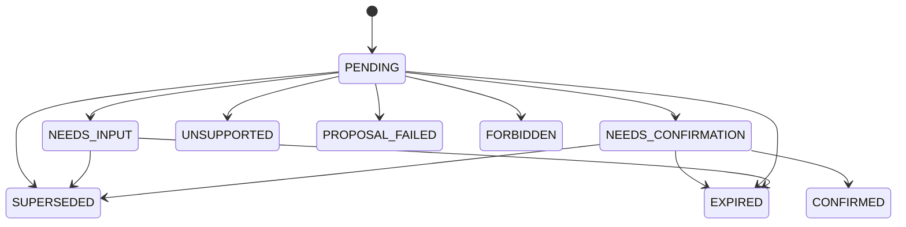

# v0.3 会话与目标确认协议

## 范围与技术决策

延续 V3.1 的 GoalContract、Registry、Dispatcher 和 Stone 固定只读 GET。M01/M03 的最小实现位于 `agent/session.py`，不新增独立服务。SQLite 用于本地事务验证；真实 PostgreSQL、企业身份、动态授权、模型费用治理及 Job Worker 留待下一阶段。真实 Stone Java 源码不修改，业务写入关闭。

## 数据模型

| 表 | 用途 | 关键约束 |
|---|---|---|
| agent_session | 主体、会话 revision、最近用户确认实体 | UUID 主键，tenant + actor 所有权 |
| goal_proposal | 原始消息、候选、有效期、状态、关联 run | UNIQUE(session_id, request_key)，UNIQUE(session_id, revision) |
| run | 已确认的单一只读任务 | 原有请求幂等约束，proposal UUID 作为托管会话请求键 |

原始消息保存在 goal_proposal；run.message 使用固定只读确认描述，不把原始未确认附加意图发给执行模型。此阶段没有单独的全量 Message 表，也不将历史流水送入模型。已确认实体是用户选择，不是领域事实。

## 状态与事务

EXPIRED 是读取时按 expires_at 计算的有效状态，不需要后台定时任务。数据库里不强制更新成 EXPIRED，确认事务仍检查时钟。新提议先查幂等记录，再校验活动 Run；同事务推进 revision、替换旧候选并保存 PENDING。模型请求在事务外执行；完成结果只有 revision、状态和有效期仍匹配才能写入。迟到响应不能覆盖新提议。PENDING 若进程中断，不会用同 key 重发模型请求；等待过期或新 key。此处仅记录提议生命周期，尚非 V3.1 完整模型 SEND_INTENT 和 token 预算协议。

确认事务验证会话归属、proposal ID、候选完全一致、权限、有效期和最新 revision；随后在同一 SQLite 写事务创建 Run、绑定 proposal.run_id、记录最近已确认实体。重复确认相同目标返回原 run_id，不新增任务；修改候选拒绝。已确认记录重放仍重新检查仓库权限。托管会话禁止通过旧结构化提交接口绕过确认。

## Context Builder 的最小语义

| 交互 | 行为 |
|---|---|
| 查询仓库1任务103 → 确认 → 完成 | 仓库1及任务103成为最近用户确认实体 |
| 那104号呢 | 从上个已确认目标继承仓库1，生成待确认任务104 |
| 查询103号库存作业 → 1号仓库 | 补全上一条有效待澄清候选，不视为已经确认 |
| 查询仓库1 → 任务103 | 补全任务 ID |
| 提出仓库2的候选但未确认 → 那104号呢 | 不回退到仓库1，重新澄清 |
| 新会话、其他用户、仓库撤权 | 不跨会话继承或泄漏候选 |
| 复合查询、条件写入、追加冻结等 | 默认有限语法拒绝；真实模型候选仍只能人工确认新单一只读目标 |

## API

| Method | Path | 行为 |
|---|---|---|
| POST | /api/v1/sessions | 创建托管会话，201 |
| GET | /api/v1/sessions/{session_id} | 授权提议历史，limit 1–100，before revision |
| POST | /api/v1/sessions/{session_id}/goal-proposals | client_request_id + message，返回 proposal_id、revision、candidate、status、expires_at |
| POST | /api/v1/sessions/{session_id}/goal-proposals/{proposal_id}/confirm | entity 必须与候选精确一致，202，返回 run_id |
| POST | /api/v1/runs/{run_id}/advance | 显式开发执行入口 |

开发 token 缺失返回 401，归属或资源访问不允许返回 403，幂等冲突/过期确认/活动 Run 返回 409，Schema 错误返回 422；提议本身也可能返回 FORBIDDEN 业务状态。history 对撤权候选返回 REDACTED，不输出原始文本。接口尚未支持 SSE 或消息实时流式显示。

## 测试及下一阶段

原有 61 项 + 新增 24 项测试。包含并发确认、迟到提议、会话隔离、权限变化、过期、历史游标、API 全链路。测试使用模拟模型和业务数据以及现有本地 HTTP 替身。下一阶段 v0.4：PostgreSQL migration、事务 repository、持久 Job 与 Worker、真实并发恢复、提议模型预算账本。随后进行真实 Stone 和模型联调；没有生产写入权限。
